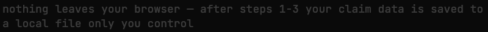
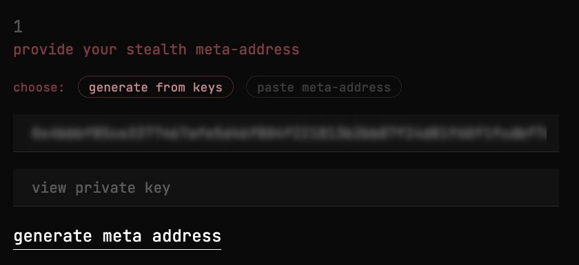
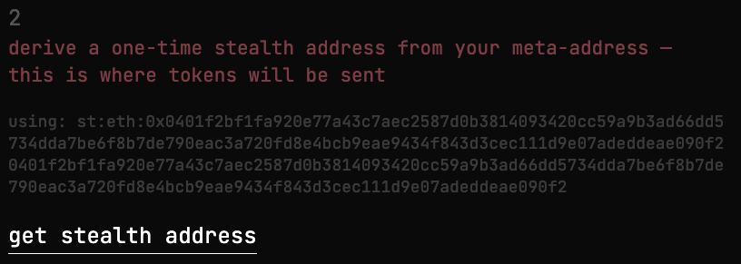
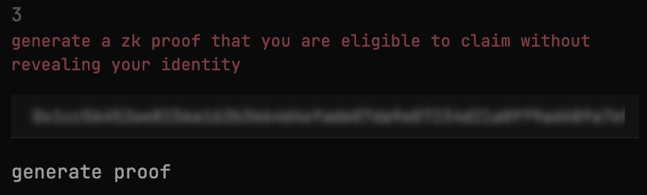
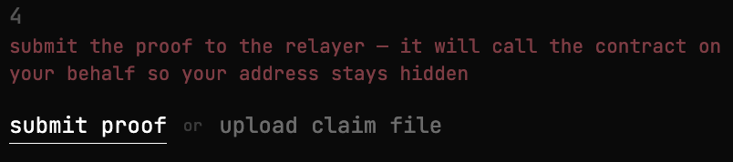

# ZK Anonymous Airdrop

Claim airdrop tokens without revealing which address is yours. A ZK proof proves you're in the eligibility list, a relayer submits it so you never touch the chain, and tokens land at a fresh stealth address — nothing on-chain connects the two.

**Noir** · **Solidity** · **Foundry** · **Next.js** · **Express** · **ERC-5564**

## Why it's anonymous

A normal airdrop: you call `claim()` from your wallet → everyone sees which address claimed and where tokens went.

Here, three things break that link:

1. **ZK proof** — proves you're eligible without revealing which address you are
2. **Relayer** — submits the transaction for you, so your address never appears on-chain
3. **Stealth address** — tokens go to a fresh one-time address generated right here in the app, that only you can control

An observer sees: *"relayer called claim → tokens went to some address."* They can't tell who's behind it.

## How to claim



1. **Generate stealth keys** — enter any two private keys (spend + view). These create a stealth meta-address

2. **Derive stealth address** — a one-time address is computed from your keys. This is where tokens will go

3. **Enter your secret** — the nullifier secret you received when added to the eligibility list. This generates a ZK proof in your browser

4. **Submit** — the proof is sent to the relayer, which calls the contract on your behalf. Tokens arrive at the stealth address


A [claim file](screenshots/claim-0x8e17Dbb6.json) is downloaded automatically — it contains everything you need, including the stealth private key to access the tokens later. See the:
[full flow](screenshots/full-flow.png),
[diagram](diagram.excalidraw) for how it all fits together.

## Stack

**Circuit (Noir)** — 20-level Poseidon2 Merkle proof + nullifier, runs in-browser via Barretenberg WASM

**On-chain (Solidity)** — UltraHonk verifier, nullifier tracking, ERC-5564 stealth announcements

**Frontend (Next.js 16)** — blurred secret inputs, claim file download with stealth private key

**Relayer (Express)** — receives proof over HTTP, submits `claim()` with its own wallet

**Testing (Foundry)** — real proof generation via FFI, fork tests against Sepolia's ERC-5564 Announcer

## Deployed on Sepolia

| Contract | Address |
|----------|---------|
| Airdrop | `0x27Ec87deF4296104f8e4546A2B520fc111292eDA` |
| Token | `0xD89BA48B8855CAbE9E81B48D9c7247C0ea977fB9` |
| Verifier | `0x662530cC219255dc66772B37B8228EE78012aA14` |
| Announcer | `0x55649E01B5Df198D18D95b5cc5051630cfD45564` |
| Relayer | `0x82f31E32512d8E62d1898981e230752D73A08322` |

Live tx: [`0x5b94a976...`](https://sepolia.etherscan.io/tx/0x5b94a976cf81767ed3ee1c80106a60081d979c0c8c2e013c109572afb5e3e7ae)

## Build

```bash
# Contracts
cd contracts && forge build && forge test

# Relayer — needs .env with RELAYER_PRIVATE_KEY, AIRDROP_ADDRESS, RPC_URL
cd relayer && npm install && node index.js

# Frontend
cd frontend && npm install && npm run dev
```

> **Note:** Tests require `ffi = true` in `foundry.toml`. Relayer runs on port 3001 by default.
